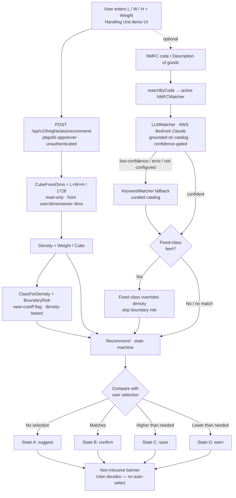

# Declare It Right, Pay It Right — Freight Class Recommender

> A recommend-only assistant for the Handling Unit screen that computes the correct LTL
> **freight class** from the dimensions and weight a user already enters — and nudges them toward
> the right, cost-viable class. **It never auto-selects; the user stays in control.**

**Team:** Right on Class · **Members:** Shivika Pruthi, Vaibhav Chichmalkar
**Track:** Agentify / Agentic Shipping & Mailing Experience · **Status:** POC (Phases 1–3 implemented)

---

## Why this exists

Shippers frequently declare the **wrong freight class**, which triggers carrier reclassification,
correction fees, and surprise invoice charges. Today the UI leaves the freight class entirely to
the user, who is often not an expert.

- **Under-declaration** → the carrier re-rates the shipment and adds reclassification fees.
- **Over-declaration** → the customer silently **overpays**.

In LTL shipping, freight is categorized into **18 classes from 50 to 500** — lower is denser and
cheaper, higher is lighter/bulkier and pricier. For the large majority of commodities the class is
a **deterministic function of density**, which is computable from what the user already types.

---

## Features

| Phase | What it does | AI? |
|---|---|---|
| **1 — Core engine** | Density → class calculator, boundary-risk flags, and a recommend state machine (suggest / confirm / save / warn) | No — pure deterministic Go |
| **2 — NMFC matcher** | Free-text goods description → NMFC item, with fixed-class commodities overriding density | Yes — **AWS Bedrock (Claude)**, keyword fallback |
| **3 — Risk + savings** | Directional boundary risk + a concrete **packing-to-cheaper-class** tip ("tighten ~2.5 cu ft to drop to class 85") | Deterministic (math) |

Additional highlights:

- **Two-field NMFC input** (prod-faithful): a **declared NMFC code** is authoritative and resolved
  deterministically; otherwise the **description** is matched (keyword → LLM).
- **Pluggable AI seam:** the matcher is an `NMFCMatcher` interface, so the LLM drops in without
  touching the calculator, HTTP layer, or UI.
- **Graceful degradation:** low confidence / API error / missing config → keyword matcher →
  density-only. The demo never breaks.
- **Embedded single-page UI** mirroring the Handling Unit screen (served from the binary, no
  external JS/CSS).

---

## Architecture



**Design philosophy — AI at the edges, deterministic core.** Density is exact math (unit-tested at
every breakpoint), so we deliberately **do not** use an LLM for the calculation — a wrong number at
a class cutoff is the one place a hallucination is unacceptable. The LLM is applied only to the
ambiguous, language-based edge: *"what commodity is this, and is it fixed-class?"*

---

## Project structure

```
cmd/freight-class-recommender/main.go   # wires routes, loads env, starts the pbgolib server
internal/freightclass/
  calculator.go     # CubeFromDims, Density, ClassForDensity, BoundaryRisk, Recommend
  savings.go        # SavingsOpportunity — packing-to-cheaper-class tip (Phase 3)
  nmfc.go           # NMFCItem, curated catalog, NMFCMatcher interface, KeywordMatcher, matchByCode
  nmfc_llm.go       # LLMMatcher — AWS Bedrock (Claude) call, confidence gate, keyword fallback
  types.go          # Input, Recommendation, Class, RiskLevel
  freightclass.go   # Context + RecommendAPI HTTP handler
  *_test.go         # unit tests (engine, matcher, LLM with mock HTTP client)
internal/web/       # index.html demo UI (embedded via //go:embed) + web.go
internal/utils/     # GetPayload (JSON decode + resterrors)
docs/               # architecture-flow.html (renders the mermaid diagram for slides)
freight-class-recommender-POC.md        # full design doc
```

**Stack:** Go (toolchain **1.27**) on Pitney Bowes **`pbgolib`** (`appserver`, `respond`,
`logging`, `resterrors`, `envvar`) — no external web frameworks. The Bedrock call uses the Go
standard library `net/http` (no AWS SDK).

---

## Getting started

### Prerequisites
- Go **1.27+** (the module sets `go 1.27.0`; with `GOTOOLCHAIN=auto` the toolchain is fetched
  automatically).
- Access to the `pbgolib` modules (private PB registry — set `GOPRIVATE` accordingly).
- *(Optional, for live AI)* an AWS Bedrock API token with an enabled Claude model.

### Run the demo
```sh
go run ./cmd/freight-class-recommender
```
Then open **http://localhost:8080**. The server seeds sane defaults, so it runs with **zero config**
(the LLM path falls back to the keyword matcher until Bedrock is configured).

### Build & test
```sh
go build ./...
go test ./...
```

---

## Configuration

Server + AI settings are read via `envvar.GetString`. For local runs they load from
[`.vscode/dev.env`](.vscode/dev.env) (gitignored); VS Code debugging uses the same file via
`launch.json`'s `envFile`.

| Variable | Purpose | Example |
|---|---|---|
| `APP_SERVER_PORT` | HTTP port | `8080` (default seeded) |
| `APP_BEDROCK_API_TOKEN` | **Secret** Bedrock API key value (the `ABSK…` string) | — |
| `APP_BEDROCK_REGION` | AWS region | `us-east-1` |
| `APP_BEDROCK_MODEL_ID` | Claude **inference-profile** id | `us.anthropic.claude-haiku-4-5-20251001-v1:0` |

Enable the live LLM matcher in `main.go`:
```go
freightclass.Matcher = freightclass.NewLLMMatcher()
```

> ⚠️ **Security:** `APP_BEDROCK_API_TOKEN` is a secret — never commit it. `.vscode/dev.env` is
> gitignored; use a rotated token and inject it via your secret store in real deployments.
> **Note:** current Claude models on Bedrock require the cross-region **inference-profile** id
> (the `us.` prefix); bare model ids return `400 … on-demand throughput isn't supported`.

---

## API

### `POST /api/v1/freightclass/recommend`

**Request (`Input`):**
```json
{
  "length": 48, "width": 40, "height": 36,
  "weightLbs": 450,
  "cube": null,
  "selectedClass": null,
  "nmfcCode": "",
  "description": "office chair"
}
```

**Response (`Recommendation`):**
```json
{
  "recommendedClass": 92.5,
  "density": 11.25,
  "selectedClass": null,
  "state": "suggest",
  "message": "Suggested class 92.5 — based on density 11.2 lb/ft³.",
  "riskLevel": "none",
  "costTip": "",
  "packingTip": "Tighten packing by ~2.5 cu ft (≈6%) to … drop from class 92.5 to 85 …",
  "targetClass": 85,
  "nmfcCode": "", "nmfcDescription": "", "nmfcFixedClass": false, "nmfcSource": ""
}
```

- **NMFC precedence:** a valid `nmfcCode` wins deterministically (`nmfcSource: "code"`); otherwise
  the `description` is matched via keyword → LLM (`nmfcSource: "description"`).
- `GET /` serves the embedded demo UI.

---

## Density → class scale

| Density (lb/ft³) | Class | Density (lb/ft³) | Class |
|---|---|---|---|
| ≥ 50 | 50 | 9 – 10.5 | 100 |
| 35 – 50 | 55 | 8 – 9 | 110 |
| 30 – 35 | 60 | 7 – 8 | 125 |
| 22.5 – 30 | 65 | 6 – 7 | 150 |
| 15 – 22.5 | 70 | 5 – 6 | 175 |
| 13.5 – 15 | 77.5 | 4 – 5 | 200 |
| 12 – 13.5 | 85 | 3 – 4 | 250 |
| 10.5 – 12 | 92.5 | 2 – 3 | 300 |
| | | 1 – 2 | 400 |
| | | < 1 | 500 |

---

## Demo cheat-sheet

Type into the **Description of goods** field:

| Input | Result | Path |
|---|---|---|
| `a box of ping pong balls` | NMFC 86150 → class **500** (fixed) | keyword |
| `small lightweight white spheres used in a paddle table sport` | NMFC 86150 → class **500** | **LLM only** |
| `something soft you sleep on` | NMFC 124530 (mattress) → class **150** | **LLM only** |
| `asdf qwerty` | no match → density-only | fallback |

Type into the **NMFC** field: `86150` → resolves deterministically as a *declared code*.

Dropdown states (vs. a density recommendation of 92.5): pick **70** → ⚠️ warn (under-declared),
**150** → 💰 save (over-declared), **92.5** → ✓ confirm.

The full catalog (~34 items) and an extended cheat-sheet live in
[`freight-class-recommender-POC.md`](freight-class-recommender-POC.md).

---

## Testing

```sh
go test ./...            # all tests
go test ./internal/freightclass/ -v   # verbose, reads like a feature tour
```
Coverage includes the density scale breakpoints, cube/density math, the four recommend states,
whole-word keyword matching, NMFC fixed-class override, code-vs-description precedence, the Phase 3
packing savings, and the LLM matcher (via an injectable mock HTTP client — no network needed).

---

## Roadmap

- **Embeddings / RAG** for the NMFC matcher once the catalog grows past ~50–100 items (today the
  whole catalog is sent to the model as grounding).
- **Rate data** to turn qualitative cost tips into dollar figures.
- **Authenticated routes** (`appserver.RouteV2`) and request-scoped context threading for production.
- **Input sanity checks** and unstructured-input parsing (packing lists / photos) at the AI edge.

---

## Credits & license

Built by **Team Right on Class** for the AI hackathon. NMFC codes/classes in the catalog are
**representative demo data** only — the full NMFC book is licensed. See [LICENSE](LICENSE).
