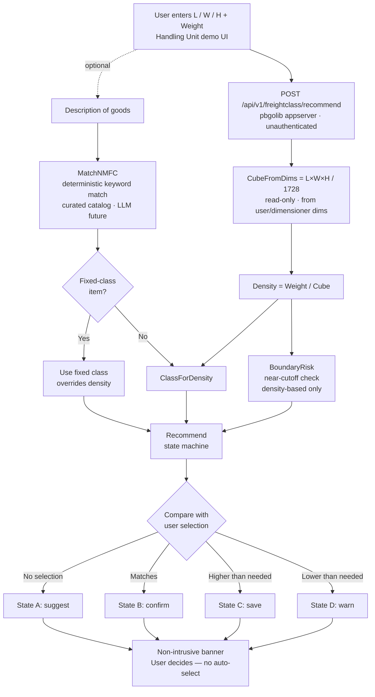

# Declare It Right, Pay It Right — Freight Class Recommender

**Team:** Right on Class
**Members:** Shivika Pruthi, Vaibhav Chichmalkar, Abhinav Kumar
**Track:** Agentify / Agentic Shipping & Mailing Experience
**Status:** POC — Phase 1 & 2 implemented
**Last updated:** 2026-10-23

---

## 1. Executive Summary

Shippers frequently declare the **wrong freight class**, which triggers carrier
reclassification, correction fees, and surprise invoice charges. Today our UI
leaves the freight class entirely to the user, who is often not an expert.

This POC adds a **recommend-only assistant** to the Handling Unit screen. Using the
dimensions and weight the user already enters, it computes the correct freight class
and surfaces a non-intrusive suggestion. **It never auto-selects** — the user stays in
control; we only nudge toward the right, cost-viable class.

---

## 2. Brief History: Why Freight Class Exists and How It's Used Efficiently

- **Origins (1930s–1950s):** As Less-Than-Truckload (LTL) trucking grew, carriers needed
  a fair, standardized way to price mixed freight sharing one trailer. The
  **National Motor Freight Classification (NMFC)**, maintained by the NMFTA, was created
  to group commodities into standardized classes.
- **18 classes (50–500):** Every commodity maps to one of 18 classes. **Lower class = denser,
  easier-to-handle freight = lower cost.** Higher class = light, bulky, fragile, or
  high-liability freight = higher cost.
- **The four factors:** NMFC classification is based on **density, stowability, handling,
  and liability**. For the large majority of everyday commodities, **density is the primary
  driver**, which makes it computable from dimensions and weight.
- **Shift to density-based rating:** Over the last two decades carriers increasingly rate on
  **actual measured density** (via dimensioners), reducing guesswork but also making
  **accurate declaration essential** — the carrier will re-measure and reclassify if the
  declared class is wrong.
- **Efficient use today:** Experienced shippers optimize cost by (a) declaring the *correct*
  class rather than over-declaring, and (b) **improving density** (tighter packing, proper
  palletization) to legitimately drop into a lower, cheaper class. Our POC operationalizes
  exactly this expertise for every user.

---

## 3. Problem Statement

- The Handling Unit UI leaves **Freight Class** as a free user choice.
- Non-expert users pick incorrectly, causing:
  - **Under-declaration** → carrier reclassification + correction/adjustment fees.
  - **Over-declaration** → the customer silently **overpays**.
- There is **no check** before the shipment leaves to confirm the class is right.

---

## 4. The Core Insight — Most Freight Class Is a Deterministic Calculation

The UI already captures Length, Width, Height and Unit Weight. From these:

```
Volume (cu ft) = (L × W × H in inches) / 1728
Density        = Weight (lbs) / Volume (cu ft)
Class          = density → NMFC density scale lookup
```

> **Note on CUBE:** CUBE is **always calculated from the L/W/H dimensions**
> (Cube = L×W×H / 1728), whether those dimensions are **entered by the user or measured by a
> dimensioner**. It is shown **read-only** — the user never edits it directly. So
> **L/W/H + Weight is the single source of truth** for volume and density.

### Density → Class scale (standard NMFC density breakpoints)

| Density (lb/ft³) | Class | Density (lb/ft³) | Class |
|---|---|---|---|
| ≥ 50 | 50 | 9 – 10.5 | 100 |
| 35 – 50 | 55 | 8 – 9 | 110 |
| 30 – 35 | 60 | 7 – 8 | 125 |
| 22.5 – 30 | 65 | 6 – 7 | 150 |
| 15 – 22.5 | 70 | 5 – 6 | 175 |
| 13.5 – 15 | 77.5 | 4 – 5 | 200 |
| 12 – 13.5 | 85 | 3 – 4 | 250 |
| 10.5 – 12 | 92.5 | 2 – 3 | 300 |
|  |  | 1 – 2 | 400 |
|  |  | < 1 | 500 |

AI/intelligence earns its place only at the edges:
- **NMFC matcher** — map free-text product description to the right NMFC item (some items are
  *fixed-class* regardless of density). This is our primary **AI use case**: the matcher is a
  pluggable `NMFCMatcher` interface. The demo ships a deterministic keyword matcher over a
  curated catalog; an **LLM/semantic matcher slots in behind the same interface** (see
  *LLM integration* in §8) — no change to the recommend pipeline or UI contract.
- **Risk checker** — flag borderline density, vague descriptions, box-only vs. palletized cube.

---

## 5. Behavior: Recommend, Never Auto-Select

Let `recommended` = class our engine computes, `selected` = what the user chose.

| State | Condition | Pop-up shown |
|---|---|---|
| **A. No selection yet** | dims + weight entered, dropdown still "Select" | *Suggestion:* "Based on density X lb/ft³, suggested class is **150**." |
| **B. Match** | `selected == recommended` | Quiet confirmation (✓), no nagging |
| **C. Over-declared** | `selected` higher than needed | *Save tip:* "You can likely use class **125** — lower cost, still valid." |
| **D. Under-declared** | `selected` lower than density supports | *Warning:* "Class 100 may be reclassified to **150**; too-low declaration risks fees." |

**Safety rule:** *Optimized must also be viable.* We never recommend a class lower than the
density/NMFC supports just to save money — that is under-declaration and is the exact cause of
reclassification fees we are trying to prevent.

---

## 6. Boundary Risk Flags

A **boundary risk flag** warns the user when the computed density lands **very close to a
class cutoff**, where a tiny measurement error flips the result into a different (usually more
expensive) class.

**Why it matters:** the density → class scale is made of hard breakpoints. A shipment
computing to **density = 14.9** is class **77.5**, but sits right on the edge of 15.0, where it
becomes class **70**. A fraction of an inch or half a pound measured differently by the
carrier's dimensioner tips the class — and the price — over.

**Two sub-cases:**
1. **Just-above risk** — barely over a boundary toward a *cheaper* class. The carrier
   re-measuring could push it back to the more expensive class → **under-declaration risk**.
2. **Just-below opportunity** — barely into a more expensive class. A tiny packing improvement
   (tighter dims, remove void space) could legitimately drop it to the cheaper class →
   **cost-saving tip**.

**Implementation (cheap, no AI):** after computing density, check the distance to the nearest
breakpoint. If within a small threshold (e.g., ~3–5% of the cutoff value), set `RiskLevel` and
add a message.

```
nearest breakpoint = 15.0
density            = 14.9
margin             = |15.0 - 14.9| / 15.0 = 0.67%  → within threshold → flag
```

> *"Density 14.9 is near the 15.0 cutoff. A small measurement difference could reclassify this
> from 77.5 to 70 (or vice versa). Double-check dimensions/weight."*

This is a small, deterministic addition to the core calculator — easy enough for Phase 1 and a
compelling demo moment ("we caught a borderline case before the carrier did").

---

## 7. Flow Diagram



---

## 8. Technical Approach

**Stack:** Go backend built on Pitney Bowes **`pbgolib`** (no external web frameworks) +
a lightweight embedded demo UI mirroring the Handling Unit screen. Module
`github.com/vairarchi/freight-class-recommender` (Go 1.27 toolchain).

**Project layout:**
- `internal/freightclass/` — core engine (pure, deterministic, unit-tested)
  - `calculator.go` — `CubeFromDims`, `Density`, `ClassForDensity`, `BoundaryRisk`, `Recommend`
  - `nmfc.go` — `NMFCItem`, curated sample catalog, `NMFCMatcher` interface + `KeywordMatcher`
  - `nmfc_llm.go` — `LLMMatcher` scaffold (AI seam, `TODO(llm)`)
  - `types.go` — `Input`, `Recommendation`, `Class`, `RiskLevel`
  - `freightclass.go` — `Context` + `RecommendAPI` handler (pbgolib `respond` / `logging`)
- `internal/web/` — single-page demo UI embedded via `//go:embed`
- `internal/utils/` — `GetPayload` (JSON decode + `resterrors`)
- `cmd/freight-class-recommender/` — `main.go` wires routes and starts the pbgolib server

**Core functions (pure Go, deterministic, unit-tested):**
- `CubeFromDims(l, w, h float64) float64` — computes CUBE from L/W/H (÷1728)
- `Density(weightLbs, cubeFt float64) float64` — guards divide-by-zero
- `ClassForDensity(density float64) Class` — the density scale lookup above
- `BoundaryRisk(density float64) (RiskLevel, message)` — near-cutoff detection
- `MatchNMFC(description string) (NMFCItem, bool)` — keyword match over the curated catalog
- `Recommend(input) Recommendation` — computes cube → density → class, applies any NMFC
  fixed-class override, checks boundary risk, and runs the state machine

**`Input` (request):**
```go
type Input struct {
    Length, Width, Height float64
    Cube                  *float64 // optional override; demo always computes from L/W/H
    WeightLbs             float64
    SelectedClass         *float64 // nil = not chosen yet
    Description           string   // free-text goods description → NMFC match
}
```

**`Recommendation` result (UI contract):**
```go
type Recommendation struct {
    RecommendedClass float64
    Density          float64
    SelectedClass    *float64  // nil = not chosen yet
    State            string    // "suggest" | "confirm" | "save" | "warn"
    Message          string
    RiskLevel        RiskLevel // none | low | medium | high
    CostTip          string
    NMFCCode         string    // matched NMFC item (if any)
    NMFCDescription  string
    NMFCFixedClass   bool      // true = class fixed by NMFC, overrides density
}
```

**HTTP layer (pbgolib `appserver`):**
- `POST /api/v1/freightclass/recommend` — accepts the `Input` JSON → returns the `Recommendation`
- `GET /` — serves the embedded demo UI
- Routes are registered as **unauthenticated** (V1 `appserver.Start`) so the demo bypasses
  token verification. Production can move them to authenticated `RouteV2`.

**UI:** single embedded page matching the Handling Unit screenshot; CUBE is read-only and
auto-computed from L/W/H. On input change it calls the recommend endpoint and renders the
non-intrusive banner (suggest / confirm / save / warn) plus boundary-risk and NMFC match info.

**AI extensions:** the Phase 2 NMFC matcher is currently a **deterministic keyword matcher**
over a small curated catalog (no external LLM/libs). A semantic/LLM matcher can slot behind
the same `MatchNMFC` / `Recommend` calls without changing the UI contract.

**LLM integration (AI use case — future TODO):** the matcher is a pluggable interface, so an
LLM can be dropped in without touching the calculator, HTTP layer, or UI:
```go
// nmfc.go — the seam
type NMFCMatcher interface {
    Match(ctx context.Context, description string) (NMFCItem, bool, error)
}
var Matcher NMFCMatcher = KeywordMatcher{} // swap this to go AI
```
- `KeywordMatcher` — deterministic, offline; powers the demo and the LLM **fallback**.
- `LLMMatcher` (`nmfc_llm.go`) — scaffold with a documented `TODO(llm)`. Enable it in one line:
  `freightclass.Matcher = freightclass.NewLLMMatcher()`.
- Planned `LLMMatcher.Match` flow: build a grounded prompt from the description + NMFC
  candidates (few-shot or embeddings/RAG over the licensed NMFC book) → call the model via
  **pbgolib `restclient`** (no external SDKs) with `ctx` → parse structured JSON
  `{code, description, fixedClass, confidence}` → confidence-gate → **fall back to
  `KeywordMatcher`** on low confidence or error so the demo never breaks.

---

## 9. Phased Scope

| Phase | Deliverable | AI? | Status |
|---|---|---|---|
| **1 — Core** | Density → class calculator + boundary flags + `/recommend` + state machine | No | ✅ Implemented |
| **2 — NMFC matcher** | Free-text description → NMFC item + fixed-class handling | Deterministic (keyword; LLM future) | ✅ Implemented |
| **3 — Risk + savings** | Richer risk checks, packing/palletizing tips, cost direction | Yes | ⏳ Planned |

Phase 1 guarantees a working demo even if later phases stay rough. Phases 1 and 2 are built,
unit-tested, and wired into the demo UI; boundary risk flags were included in Phase 1.

---

## 10. Expected Business / User Impact

- **Better accuracy** — fewer wrong declarations, fewer carrier reclassifications.
- **Customer retention and trust** — no surprise invoice adjustments.
- **Lower cost** — avoid over-declaration overpay; legitimate class reduction via packing tips.
- **Scales expertise** — every user gets expert-level classification without training.

---

## 11. Open Questions for the Team

1. ~~Include **boundary risk flags** in Phase 1 (cheap) or defer to the Phase 3 risk checker?~~
   **Resolved:** included in Phase 1.
2. Cost tips **qualitative** ("lower class, lower cost") or do we have **rate data** for dollar figures?
   *(Current: qualitative; no rate data wired yet.)*
3. ~~NMFC data: build a **small curated sample set** for the demo (full NMFC book is licensed)?~~
   **Resolved:** curated sample catalog built in `nmfc.go`.
4. ~~Confirm the demo UI should visually match the Handling Unit screenshot.~~
   **Resolved:** demo UI mirrors the Handling Unit screen.

---

## Appendix: Key Formulas

```
Volume (cu ft) = (L × W × H in inches) / 1728
Density        = Weight (lbs) / Volume (cu ft)
Boundary margin = |nearest_breakpoint - density| / nearest_breakpoint
```
